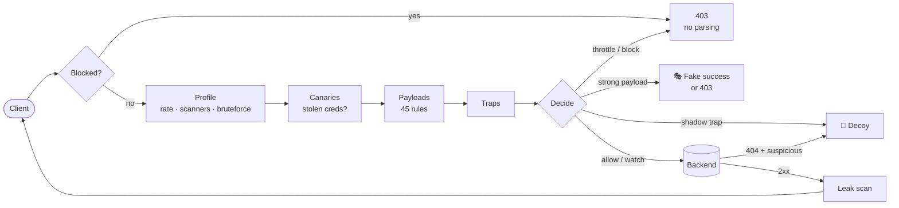

<p align="center">
  
</p>

<p align="center">
  <a href="https://github.com/davezant/rbproxy/actions/workflows/ci.yml"></a>
  <a href="go.mod"></a>
  <a href="LICENSE"></a>
  
  
</p>

<p align="center">
  <b>Detect</b> attacks &nbsp;·&nbsp; <b>profile</b> every client &nbsp;·&nbsp; <b>deceive</b> the ones who probe
</p>

<p align="center">
  <a href="#-quick-start">Quick start</a> •
  <a href="#-how-it-works">How it works</a> •
  <a href="#-honeypots">Honeypots</a> •
  <a href="#%EF%B8%8F-configuration">Configuration</a> •
  <a href="#-admin-api">Admin API</a> •
  <a href="#%EF%B8%8F-roadmap">Roadmap</a>
</p>

---

**RBProxy** is a reverse proxy you put in front of your web application. It
sends real users straight to the backend and **turns scanners and script
kiddies into a source of intelligence**. They get fake `.env` files, phantom
admin panels and database dumps that look real, each filled with **canary
credentials made for that one attacker**. When those credentials come back,
from any IP, you know exactly who stole them.

A WAF only says *no*. RBProxy says *"sure, here you go"* and writes down
everything the attacker does with it.

```text
$ rbproxy host -t http://127.0.0.1:3000
01:58:22 [rbproxy] rbproxy 0.2.0 — mode deceive, 45 detection rules, honeypots on
01:58:22 [rbproxy] listening on http://:8080 → http://127.0.0.1:3000
01:58:23 MEDIUM   honeypot_hit   203.0.113.7   GET  /.env                        trap dotenv
01:58:25 HIGH     attack         203.0.113.7   GET  /produto?id=1'%20OR%20'1'='1  sqli (score 9)
01:58:25 MEDIUM   pattern        203.0.113.7   GET  /backup/                     scanner:nikto
01:58:27 CRITICAL canary_used    198.51.100.4  POST /login                       stolen honeypot credential used (stolen by 203.0.113.7)
01:58:27 HIGH     blocked        198.51.100.4  POST /login                       threat score 104
```

## ✨ Features

<table>
<tr>
<td width="33%" valign="top">

### 🔍 Detect
- **45 weighted rules**: SQLi, XSS, command injection, path traversal, SSTI, NoSQL, CRLF, PHP/Java/Python code, **Log4Shell**, XXE, SSRF
- Checks the path, query, headers, cookies and body, **after decoding** (double URL encoding, HTML entities, `UNION/**/SELECT`)
- **Leak detection** in responses: AWS/GitHub/Stripe keys, private keys, `.env` lines, stack traces, SQL errors, with optional redaction

</td>
<td width="33%" valign="top">

### 🧠 Profile
- One threat score per client (IP, or the whole **/64 for IPv6**) that **decays** over time
- Catches **scanners** (sqlmap, nikto, nuclei, ffuf…), **404 enumeration**, **brute force**, user agent rotation and floods
- Escalates automatically: `allow → watch → throttle → block → blacklist`
- Understands `X-Forwarded-For` behind trusted CDNs only

</td>
<td width="33%" valign="top">

### 🍯 Deceive
- Built-in traps: `.env`, `.git`, `.aws`, WordPress, phpMyAdmin, Spring Actuator, dumps, webshells…
- **Spontaneous decoys**: suspicious clients get believable content instead of 404s
- **Learns new traps** from what attackers probe
- **Per-attacker canaries** that link IPs together
- Captures logins on fake panels and **tarpits** scanners

</td>
</tr>
</table>

## 🚀 Quick start

```sh
git clone https://github.com/davezant/rbproxy && cd rbproxy
go build -o rbproxy .

# put it in front of your app
./rbproxy host --target http://127.0.0.1:3000 --listen :8080 --admin 127.0.0.1:9090
```

Then try to attack your own site:

```sh
curl http://localhost:8080/.env                          # a fake .env with canary credentials
curl "http://localhost:8080/item?id=1'%20OR%20'1'='1"    # a fake MySQL error; the backend is never touched
curl -A "Nikto/2.5" http://localhost:8080/backup/        # a fake directory listing full of traps
./rbproxy report                                         # what just happened
```

> [!TIP]
> On a real site, run `--mode monitor` for a few days first and review `rbproxy report` for false positives. Then switch to the default `deceive` mode.

## 🧭 How it works



Every client has a **threat score**. Payloads, trap hits and behaviour add to
it, and it halves every 10 minutes:

| Score | Action | What happens |
|---:|---|---|
| `< 15` | **allow** | forwarded as usual |
| `≥ 15` | **watch** | any payload gets a decoy, every 404 becomes a honeypot |
| rate limit | **throttle** | `429 Too Many Requests` |
| `≥ 60` | **block** | 15 min, doubling on each repeat; the 3rd block is a **permanent blacklist** |

<details>
<summary><b>Reference weights</b></summary>

| Signal | Score |
|---|---:|
| Reusing a stolen canary credential | 50 |
| Known scanner user agent | 20 |
| Brute force on a login endpoint | 15 |
| Touching `.aws`, `.ssh` or a webshell | 15 |
| 404 enumeration | 12 |
| Touching `.env` or `.git` | 12 |
| `UNION SELECT`, `<script>`, Log4Shell… | 7–10 per category |
| User agent rotation | 8 |

</details>

### Modes

| Mode | Attack payloads | Abusive clients | Honeypots |
|---|---|---|---|
| `monitor` | logged, forwarded | logged | learned only |
| `protect` | `403` | `403` / `429` | shadow traps → `404` |
| `deceive` *(default)* | **fake success** (SQL errors, `/etc/passwd`, `uid=33(www-data)`) | `403` / `429` | **everything** |

## 🍯 Honeypots

| Trap | Examples | Behaviour |
|---|---|---|
| Secrets | `/.env`, `/.git/config`, `/.aws/credentials`, `/.ssh/id_rsa`, `wp-config.php.bak` | **Shadow**: never forwarded, so a real leaked file is never served |
| Exploit targets | `eval-stdin.php`, `shell.php`, `/boaform/`, `/_ignition/…` | Shadow; the payload is logged and the webshell answers with nothing |
| Panels | `/wp-login.php`, `/phpmyadmin`, `/admin`, `/manager/html` | Forwarded first; becomes a decoy **only if the backend answers 404**, so your real `/admin` keeps working |
| Data | `backup.sql`, `db.zip`, `dump.tar.gz` | Valid SQL, zip and gzip files with canaries inside |
| Info | `/phpinfo.php`, `/server-status`, `/actuator/env` | Fake internals that point to more traps |
| **Learned** | anything | A path probed by **3 different suspicious clients** becomes a permanent trap |
| **Spontaneous** | anything | A suspicious client's 404 becomes a directory listing, config file or dump, depending on the path |

### Canaries: following stolen credentials

```text
 203.0.113.7  ──GET /.env──────────▶  DB_PASSWORD=oiyBgujzj0AsSj3Scq   (issued only to 203.0.113.7)
                                       ADMIN_PASSWORD=Qm7rT2kPz9LwXa
                       ⋮  three days later, another IP  ⋮
198.51.100.4  ──POST /login─────────▶  password=Qm7rT2kPz9LwXa
                                       CRITICAL canary_used  stolen by 203.0.113.7
                                       → both IPs linked, +50 score, blocked
```

## 📊 Reports

Example output (trimmed):

```text
$ rbproxy report --since 24h
RBProxy report — 1 284 events from 2026-11-06 02:00 to 2026-11-07 01:58

ATTACK CATEGORY  REQUESTS
sqli             412
traversal        167
xss              98
jndi             31

TOP CLIENTS     WORST     EVENTS  ATTACKS  TRAPS  CATEGORIES          LAST SEEN    USER AGENT
203.0.113.7     critical  341     212      38     sqli,traversal,xss  11-07 01:40  sqlmap/1.8#stable
198.51.100.4    critical  12      0        2                          11-07 01:58  python-requests/2.31

STOLEN CANARIES USED  STOLEN BY    CANARY          WHEN
198.51.100.4          203.0.113.7  admin-password  11-07 01:58

LEARNED TRAPS          WHEN
/api/v0/debug          11-06 14:12
```

Every event is also written as one JSON object per line to
`rbproxy-events.jsonl`, ready for `jq`, Loki, Elastic or your SIEM.

## ⚙️ Configuration

Everything works with flags. For more control, generate a config file:

```sh
rbproxy settings --write rbproxy.json   # every option with its default
rbproxy settings --check rbproxy.json   # validate it
rbproxy host --config rbproxy.json
```

```jsonc
{
  "sites": [
    { "listen": ":443", "target": "http://127.0.0.1:3000", "cert": "cert.pem", "key": "key.pem" },
    { "listen": ":8443", "target": "http://127.0.0.1:4000" }
  ],
  "mode": "deceive",
  "trusted_proxies": ["173.245.48.0/20"],  // your CDN, or every request looks like it comes from it
  "leaks": { "detect": true, "redact": true },
  "profile": { "watch_score": 15, "block_score": 60, "block_duration": "15m", "blacklist_after": 3 },
  "honeypot": { "enabled": true, "tarpit": true, "learn_threshold": 3 }
}
```

The full reference is in [documentation/Setup.md](documentation/Setup.md).

## 🛰 Admin API

```sh
curl localhost:9090/api/stats                                   # counters, uptime
curl 'localhost:9090/api/clients?min_score=15'                  # suspicious clients, highest score first
curl localhost:9090/api/clients/203.0.113.7                     # full profile: tags, paths, UAs, linked IPs
curl -X POST 'localhost:9090/api/clients/203.0.113.7/block?minutes=0'   # blacklist
curl -X POST localhost:9090/api/clients/203.0.113.7/unblock
curl 'localhost:9090/api/events?n=50&min_severity=high'
curl localhost:9090/api/traps                                   # built-in and learned traps
```

The API refuses to listen on a public address without `--admin-token`.

## 🗂 Project layout

```text
cmd/                 CLI: host, settings, report
pkg/proxy/           reverse proxy, request pipeline, admin API
internal/security/   detection rules, leak scanner, block page
internal/profile/    per-client behaviour, scores, blocks
internal/honeypot/   traps, decoys, canaries, templates
internal/events/     JSONL event log + in-memory ring
internal/config/     JSON configuration
documentation/       About, Installation, Setup
```

## 🗺️ Roadmap

- [x] HTTP/HTTPS reverse proxy with several sites
- [x] Weighted attack detection with decoding
- [x] Client profiling, decaying scores, escalating blocks
- [x] Spontaneous, learned and canary-based honeypots
- [x] Response leak detection and redaction
- [x] Event log, report command, admin API
- [ ] Lua plugins for custom rules and decoys
- [ ] Sandboxed analysis of uploaded files
- [ ] Live TUI dashboard
- [ ] Persist scores and learned traps across restarts
- [ ] GeoIP / ASN enrichment

## ⚠️ Responsible use

RBProxy is a **defensive** tool. Run it only in front of systems you own or
are allowed to protect. Decoys never hand out real data, and canaries are
random values made for each attacker. Captured passwords are masked by default
(`honeypot.log_passwords`). Depending on where you operate, logging visitor IPs
may fall under privacy laws such as GDPR or LGPD, so set a retention policy for
the event log.

## 🤝 Contributing

Issues and pull requests are welcome. Before opening a PR:

```sh
gofmt -l .        # should print nothing
go vet ./...
go test -race ./...
```

A new detection rule needs a test case that matches **and** a clean input that
must not match.

## 📄 License

[Apache 2.0](LICENSE) © 2026 RBProxy
